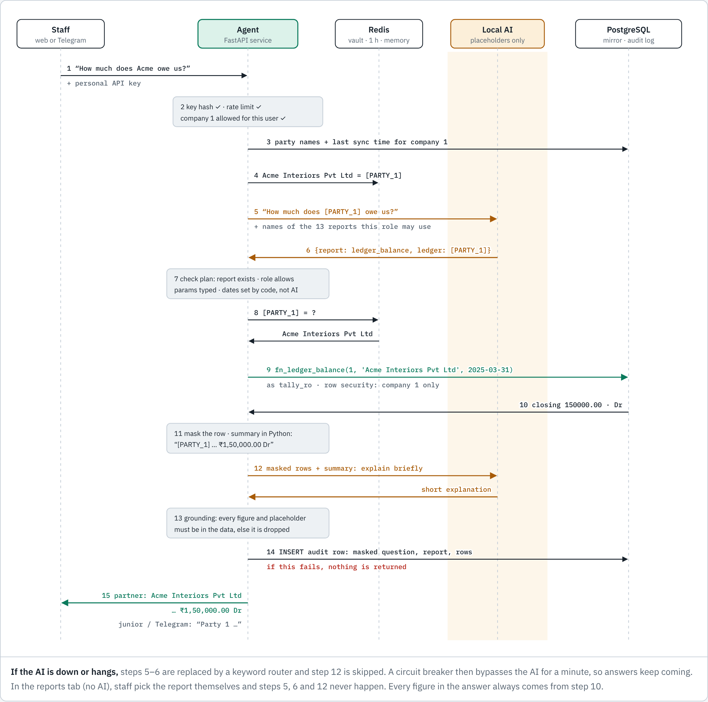
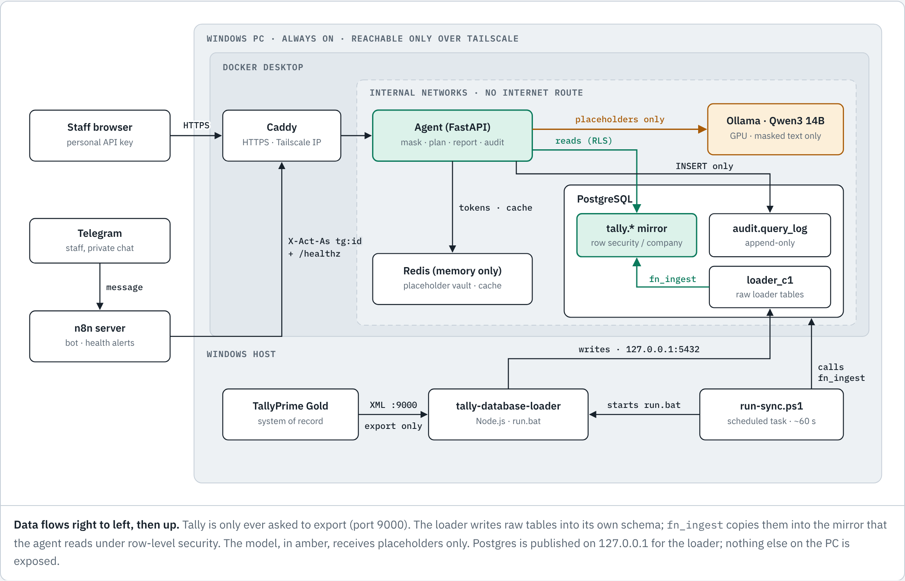

# Tally AI Agent

Staff at a CA firm ask questions in plain English and get answers from **TallyPrime** in seconds:

> *How much does Acme owe us?* · *Receivables ageing* · *Net profit for FY 2024-25* · *Which supplier bills are pending?*

Everything runs on the firm's own PC, with a **local AI model**. No client data goes to any cloud AI service.



## How it stays safe and accurate

| Rule | What it means |
|---|---|
| **The AI never sees client details** | Party names, PAN, GSTIN, Aadhaar, phone numbers, emails and bank account numbers are replaced with placeholders such as `[PARTY_1]` before any text reaches the model. |
| **The AI never writes SQL** | It chooses one of 15 fixed, reviewed reports (trial balance, ledger balance, ageing, P&L, balance sheet, GST and more) and fills typed parameters. Nothing else can run. |
| **The AI never produces a number** | Every figure is computed in code from the books. An AI-written explanation is dropped unless its figures match the data. |
| **Every question is recorded** | An append-only audit log stores the masked question, the report and the row count. If it can't be written, no answer is returned. |
| **Each person sees only what they should** | Access is per company. Juniors and Telegram users see "Party 1" instead of real names. Removing a person from the user list takes effect immediately. |

If the AI is down, a keyword router still answers. If the GPU fails, the **Reports (no AI)** tab still works.

## How it works



- **Sync:** TallyPrime is only ever read, through its XML port. [tally-database-loader](https://github.com/dhananjay1405/tally-database-loader) copies the books into PostgreSQL about once a minute. A checked import step then moves them into a copy protected by row-level security.
- **Ask:** staff ask through a web page or a Telegram bot (via n8n). Caddy serves both over HTTPS, reachable only on the firm's Tailscale network.
- **Answer:** the agent masks the question, the local model (Qwen3 14B on Ollama) picks a report, and the database runs it. The answer comes back with real names only for people allowed to see them.

All seven diagrams are in [`tally-agent/docs/diagrams/`](tally-agent/docs/diagrams/). For all of them on one page, download [`blueprint.html`](tally-agent/docs/diagrams/blueprint.html) and open it in a browser.

## Get started

| Document | For |
|---|---|
| [**Setup guide (Windows)**](tally-agent/SETUP-WINDOWS.md) | Every command, from cloning to a working system, Telegram bot and backups |
| [Project README](tally-agent/README.md) | What's in each folder, what is and isn't verified, tuning |
| [Security model](tally-agent/SECURITY.md) | Threats, controls and the test that proves each one; DPDP Act notes |

Quick start on the Tally PC:

```powershell
cd C:\
git clone https://github.com/thenexgencfo/Tally-AI-Agent-.git TallyAI
```

Then follow the [setup guide](tally-agent/SETUP-WINDOWS.md) from Part B.

## What's in this repository

| Path | What it is |
|---|---|
| `tally-agent/app/` | The agent: masking, AI planner, reports, audit, web page (Python, FastAPI) |
| `tally-agent/sql/` | Database schema, the 15 report functions, row-level security, audit log, import step |
| `tally-agent/deploy/` | Docker Compose, Caddy and environment template |
| `tally-agent/sync/`, `tally-agent/scripts/` | Windows sync runner, company setup, API keys, encrypted backup and restore |
| `tally-agent/n8n/` | Telegram bot and health-alert workflows |
| `tally-agent/tests/` | 167 automated tests, including messy production-like data, outages and hostile input |
| `tally-agent/docs/diagrams/` | Architecture diagrams |
| `FORMS-SETUP.md`, `audit-common.js`, `form-tests/` | Left over from the store audit forms, whose pages were removed from this repository |

## Built with

TallyPrime (XML export) · tally-database-loader · PostgreSQL 16 · Redis · Ollama with Qwen3 14B · Python / FastAPI · Caddy · Tailscale · Docker Desktop · n8n

## Status

The code, database and containers have been tested end to end: 167 automated tests, plus a full container run. Before staff rely on it, three things still need checking on the firm's own PC:

1. The real AI model on the GPU.
2. The agent's trial balance against Tally's own, for a real company.
3. The Windows scripts.

The setup guide covers each one.
