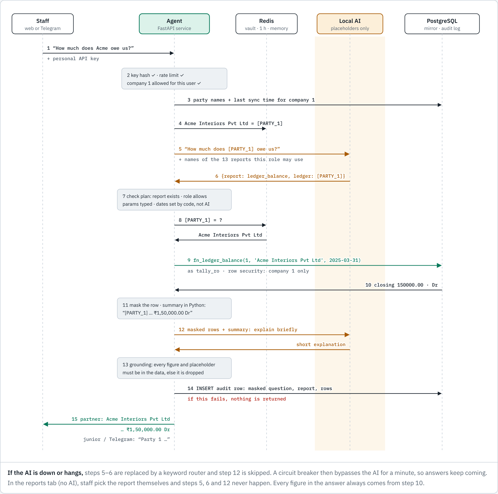

# Tally Agent

Staff at a CA firm ask questions in plain English and get answers from Tally in seconds:

> *How much does Acme owe us?* · *Receivables ageing* · *Net profit for FY 2024-25* · *Which supplier bills are pending?*

Everything runs on the firm's own machine with a local model. No client data goes to any cloud AI.

## Diagrams

Step-by-step diagrams are in [`docs/diagrams/`](docs/diagrams/). Open `docs/diagrams/blueprint.html` in a browser for all of them on one page, in light or dark mode:

1. **System architecture:** where each piece runs.
2. **Sync pipeline:** how the copy of Tally is refreshed.
3. **One question, step by step:** what reaches the AI, Redis and PostgreSQL.
4. **Masking:** what the AI never sees.
5. **Database permissions:** which login can touch what.
6. **Failure handling:** what staff see when something breaks.
7. **Store audit forms:** how the forms reach n8n.



## The three rules the design rests on

1. **The model never sees a client identifier.** PANs, GSTINs, Aadhaar, bank details, phone numbers, emails and party names are replaced with placeholders such as `[PARTY_1]` before the model gets any text.
2. **The model never writes SQL.** It picks one of 15 fixed, reviewed reports and fills in typed parameters. There is no free-form query path anywhere.
3. **The model never produces a number.** Python computes every figure from the database. The model may add an explanation, which is shown only if every figure and name in it appears in the data.

If the model is down, a keyword router answers instead. If the GPU dies, the **Reports (no AI)** tab in the web UI still works.

## How a question is answered

```
"How much does Acme owe us?"
   │  mask (party names from the ledger masters + PAN/GSTIN/... patterns)
   ▼
"How much does [PARTY_1] owe us?"  ──►  local model (Qwen3 14B)  ──►  {report: ledger_balance, ledger: [PARTY_1]}
   │                                     sees ONLY masked text          validated against the registry + role
   ▼
[PARTY_1] → "Acme Interiors Pvt Ltd"  ──►  tally.fn_ledger_balance(...)  under row-level security
   │
   ▼
rows masked again → summary computed in Python → optional model explanation, grounding-checked
   │
   ▼
shown with real names to partners/seniors, as "Party 1" to juniors and on Telegram
every request written to an append-only audit log first; if that fails, nothing is returned
```

## Architecture

```
 Windows PC (24x7, RTX 5060 Ti 16 GB)
 ┌───────────────────────────────────────────────────────────────────────────┐
 │ Tally Prime Gold ──XML :9000──► tally-database-loader ──► PostgreSQL       │
 │   (system of record)            (sync/run-sync.ps1,        loader_c1 schema│
 │                                  every ~60 s)               │ fn_ingest()  │
 │                                                             ▼              │
 │  Docker Desktop ┌─ backend network (internal: NO internet) ──────────────┐ │
 │                 │  postgres (tally.* mirror, RLS, audit.*)                │ │
 │                 │  redis    (cache + placeholder vault, memory only)      │ │
 │                 │  ollama   (qwen3:14b on the GPU)                        │ │
 │                 │  agent    (FastAPI: masking, planner, reports, audit)   │ │
 │                 └──────────────────────────┬──────────────────────────────┘ │
 │                                       caddy (TLS) bound to Tailscale IP    │
 └──────────────────────────────────────────────┬────────────────────────────┘
                                                │ tailnet only
                      staff laptops/phones ─────┤
                      n8n (Telegram bot, alerts)┘
```

## What's in this folder

| Path | What it is |
|---|---|
| `sql/01–06` | Mirror schema, sync metadata, the 15 report functions, row-level security, append-only audit log, and the loader → mirror ingest bridge |
| `sql/admin/add_loader_company.sql` | Gives one Tally company its own loader login and schema |
| `app/masking/` | Identifier recognizers (with a Verhoeff checksum for Aadhaar), the party-name index, and the Redis placeholder vault |
| `app/reports/registry.py` | The 15 reports, their typed parameters and the minimum role for each. This is the security boundary |
| `app/agent/` | Date resolution (Indian FY), Ollama client, planner plus keyword fallback, answer composition and grounding check, live Tally lookup |
| `app/service.py` | The ask pipeline, steps 1–10 |
| `app/main.py`, `app/static/` | HTTP API and the staff web UI |
| `deploy/` | Docker Compose, Caddyfile, Postgres init script, `.env.example` |
| `sync/` | Windows sync runner and example loader and company configs |
| `scripts/` | DB setup, API keys, company provisioning, encrypted backup and restore, test runner |
| `n8n/` | Health/sync alert workflow and the Telegram bot workflow |
| `tests/` | 167 tests, including production-condition robustness (`test_robustness.py`), covering the security claims end to end. See `SECURITY.md` |

## Reports available

Top overdue parties (creditors or debtors past their credit days, ranked) · trial balance · ledger balance · ledger statement (running balance) · bills outstanding (bill-wise, aged) · ageing summary · P&L summary · P&L detail · balance sheet · day book · top parties · cash and bank · GST ledger summary · voucher search · party master details (GSTIN, PAN, contact; **senior and partner only**).

To add a report, write a SQL function in `sql/03_reports.sql`, add an entry to `app/reports/registry.py`, and write a test. The model can use a report only after that reviewed change.

## What has been verified, and what hasn't

**Verified here**
- All tests pass against real PostgreSQL 16 and Redis. The demo company's figures were checked by hand: the trial balance balances at ₹10,51,000, net profit is ₹1,49,000, and the ageing buckets match.
- The ingest bridge works against a schema built from tally-database-loader's published DDL, and re-running it is idempotent.
- The full Docker stack (Postgres, Redis, agent, Caddy) built and answered questions over TLS: correct answers, masked audit rows, 403 on cross-company requests, 413 on oversized bodies, and all security headers present.

**Not verified. Do these before relying on the system:**
1. **The real model.** This build machine has no GPU, so the planner and explainer were tested with a fake model that records its prompts. Routing quality with Qwen3 on the 5060 Ti has to be measured. Collect 50 real questions from the staff with known answers and check them (see step 10 of the install).
2. **Real Tally and loader output.** The demo data is fabricated. Run the loader against a copy of a real company, then compare the agent's trial balance with Tally's own, ledger by ledger.
3. **The Windows scripts** (`*.ps1`) were written for Windows PowerShell 5.1 but never executed: there was no Windows machine available. Run each one once by hand.
4. **The n8n workflows** were written by hand. After importing, re-select the credentials and check each node.
5. **Live Tally lookups** (for "right now" questions) use a standard Tally XML Export request that hasn't been tested against your Tally release. They're off by default.
6. **Closing stock kept only in inventory.** If a company values stock through inventory (not closing-stock values on a Stock-in-Hand ledger), the loader does not export a stock value, so P&L, trial balance and balance sheet exclude it; answers say so when this applies.

## Install on the Windows PC

**Step-by-step guide with every command: [SETUP-WINDOWS.md](SETUP-WINDOWS.md).** Summary:

Prerequisites: Tally Prime Gold with the XML server enabled (F1 › Settings › Connectivity › Client/Server › *Both*, port 9000); Docker Desktop on WSL2 with GPU support and a current NVIDIA driver (the RTX 50 series needs a recent one); Tailscale; Node.js (for the loader); [age](https://age-encryption.org) for backups.

1. **Secrets.** Copy `deploy/.env.example` to `deploy/.env` and fill in every secret using the CSPRNG command shown in that file. Set `CADDY_BIND_IP` to the output of `tailscale ip -4`, and `AGENT_HOSTNAME` to the same IP.
2. **Users.** Copy `config/users.example.json` to `config/users.json`. For each person, run `.\scripts\new-api-key.ps1`, give them the key, and store only the hash. Roles are `junior`, `senior` or `partner`. `may_unmask: false` shows names as "Party 1". The Telegram bridge entry must keep `force_masked: true`. Edits take effect immediately, with no restart.
3. **Model.** From `deploy/`, run:
   ```
   docker compose --env-file .env --profile setup run --rm ollama-pull
   ```
   This is the only step that needs internet. The running model has no route out.
4. **Start.** Run `docker compose --env-file .env up -d --build`. Then bump the pinned image tags in `docker-compose.yml` to current patch releases and re-run the tests. The Ollama tag especially needs a current release for RTX 50-series support.
5. **IP allow-list.** On Docker Desktop, Caddy sees the Docker bridge address, not the tailnet address. This was confirmed during the build. Open `https://<tailscale-ip>` once, check `docker compose logs caddy` for the `remote_ip`, and set `ALLOWED_CIDRS` to include it. The real boundary is binding Caddy to the Tailscale IP, plus the next step.
6. **Firewall and ACLs.** Windows Firewall: allow inbound 443 on the Tailscale interface only. Postgres is bound to loopback already. In Tailscale ACLs, allow only staff devices and the n8n host to reach this machine on 443.
7. **Company.** Run `.\scripts\add-company.ps1 -CompanyId 1` and note the loader password it prints.
8. **Loader.** Download [tally-database-loader](https://github.com/dhananjay1405/tally-database-loader) into `C:\TallyAI\tally-agent\loader\c1`. Put `config.json` there based on `sync/loader-config.example.json`, with that password and the exact Tally company name. Run it once with `"sync": "full"`, then switch to `incremental`. Keep `loadmethod: insert`, because file loading can't reach a database inside Docker.
9. **Sync.** Write `sync\companies.json` and test with `.\sync\run-sync.ps1 -Once`. Then register it as a Scheduled Task (the command is in the script header) and check the sync badge in the web UI.
10. **Acceptance test.** Collect around 50 real questions from staff, each with an answer checked in Tally. Run them through the UI. Any routing miss means extending a keyword rule or a report description. Repeat this after every model change.
11. **n8n.** Import `n8n/*.json`, attach credentials, and set the agent URL. To trust Caddy's internal CA, export `/data/caddy/pki/authorities/local/root.crt` from the Caddy container and point `NODE_EXTRA_CA_CERTS` at it on the n8n host. Map each person's Telegram ID in `users.json`.
12. **Backups.** Create a key with `age-keygen`, keep the private key off this machine, and set `TALLY_BACKUP_AGE_RECIPIENT`. Schedule `scripts\backup.ps1` nightly, and do a real `restore.ps1` drill every quarter.

## Development (Linux or WSL)

```bash
python3 -m venv .venv && ./.venv/bin/pip install -e '.[dev]'
./scripts/test.sh -q                      # rebuilds the demo DB, runs all tests
REFERENCE_DATE=2025-03-31 USERS_FILE=config/users.json LLM_ENABLED=false \
  ./.venv/bin/uvicorn app.main:app --port 8080
```

The demo company's books end on 31 March 2025, so `REFERENCE_DATE` pins "today" to that date.

## Tuning

- **Model.** `OLLAMA_MODEL=qwen3:14b` is the starting point for 16 GB. If latency matters more than routing quality, try `qwen3:8b`. Benchmark any candidate against your 50-question set, not public leaderboards.
- **Speed.** Most of the time goes to the model. `LLM_NARRATE=false` drops the explanation call, which roughly halves response time. The answer itself never depends on the model.
- **Freshness.** `run-sync.ps1 -IntervalSeconds 60` is a sensible floor. Faster polling can slow Tally for the people entering data.
